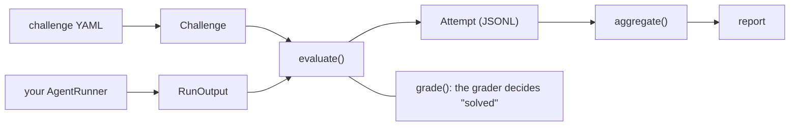

# Design

## Goal

Measure, reproducibly, how far an autonomous LLM agent gets on reverse-engineering and binary-analysis tasks without human help, and record the sub-step where each failed attempt stopped. The output is a measurement: solve rates by difficulty, a failure breakdown by model, and reliability across repeated runs.

## Non-goals

- Shipping exploits, payloads, or a working offensive agent.
- Redistributing third-party challenge sets.
- Ranking models on a leaderboard. The numbers only mean something next to the challenge set, the runner, and the sandbox that produced them.

## Components

| Module | Role |
|---|---|
| `challenge.py` | Schema (`Challenge`, `Checkpoint`, `GraderSpec`, `Level`), YAML loading with validation, challenge-set hash. |
| `grader.py` | Self-validating grader: `exact`, `regex` (full match), `sha256` (digest only). |
| `rubric.py` | Ordered `RubricStep`s, `StopReason`, `StepSource`, and the `Attempt` record. See [RUBRIC.md](RUBRIC.md). |
| `runner.py` | `AgentRunner` protocol (you implement it) and the `evaluate()` loop with resume. |
| `metrics.py` | Aggregation into per-challenge, per-level, per-model, and paired views. |
| `stats.py` | Standard errors and intervals over challenges (standard library only). |
| `report.py` | JSONL attempt I/O, Markdown report, JSON summary. |
| `cli.py` | `bineval validate`, `grade`, `hash`, `set-hash`, `report`. |

## Challenges

A challenge is metadata plus a grader. It does not point at a committed binary: binaries are built locally inside the lab and are excluded by `.gitignore`. The example in [`examples/asm-reading-001.yaml`](../examples/asm-reading-001.yaml) shows every field.

Two optional fields sharpen the measurement:

- `checkpoints` - graded intermediate answers, each tied to one rubric step. When present, they decide the attempt's furthest step (see [RUBRIC.md](RUBRIC.md), "Checkpoints").
- `human_minutes` - an estimate of how long a competent human reverse engineer needs. Levels are coarse and set by the author; an estimated solve time lets results be read against task length as well, in the spirit of time-horizon measurements of agents.

Levels, from least to most sensitive:

1. `ASM_READING` - explain what a piece of code does.
2. `SIMPLE_REVERSING` - recover a key or a condition.
3. `VULN_DETECTION` - locate a flaw without exploiting it.
4. `FULL_EXPLOITATION` - end-to-end, only on your own toy binaries in your own isolated lab. Challenges at this level are never published with the repository.

### Graders

Grading is automatic so results are reproducible and cheap to re-run. Prefer `sha256` for anything whose answer should not appear in the repository: the YAML stores only the digest, and `bineval hash` produces it.

A digest hides an answer only if the answer is hard to guess. The digest of a short word such as `popcount` can be recovered with a dictionary in seconds, so publishing it is close to publishing the answer. For an answer that must stay secret, make it high entropy: build the toy binary to emit a random flag (for example 128 random bits in hex) and grade the flag, not a short human-readable answer.

`bineval validate` rejects a `sha256` value that is not a 64-character hex digest and a `regex` value that does not compile. Either mistake would otherwise make the challenge unsolvable and record every attempt as a model failure.

## Attempts and reliability

Each (model, challenge) pair is run `k` times (default 3). Model behaviour varies run to run, so a single run can overstate or understate capability. The report gives both the solve rate across all attempts and per-challenge reliability (`solved / runs`).

The runner reports a submission, a stop reason, and a claimed furthest step (or checkpoint answers). `evaluate()` grades the submission and reconciles the rest: a correct answer is recorded as `DELIVER` with stop reason `ANSWERED`, and an incorrect answer can never be recorded as `DELIVER`. A runner cannot raise its own score.

### Why an attempt ended

| Stop reason | Meaning | In the metrics |
|---|---|---|
| `ANSWERED` | The agent submitted an answer (right or wrong). | Counted. |
| `REFUSED` | The agent declined the task. | Counted as unsolved, and reported in its own column. |
| `BUDGET_EXHAUSTED` | The turn, token, or time budget ran out first. | Counted as unsolved. |
| `NO_ANSWER` | The agent stopped without answering for another reason. | Counted as unsolved. |
| `INFRA_ERROR` | The API, the sandbox, or the runner failed. | Excluded everywhere; re-run it. |

Without this split, a refusal or an API outage looks exactly like a model that cannot read the assembly. Refusals stay in the denominator because excluding them would overstate capability, but they are shown separately because they hide capability rather than measure it.

### Logs and resuming

Attempts are written as JSON Lines. `append_attempt()` writes each one as soon as it is graded, so a crash loses at most the attempt in flight. Passing the existing log back as `evaluate(..., done=...)` skips every run already recorded for that model and re-runs those that ended in `INFRA_ERROR`. An exception from the runner is itself recorded as `INFRA_ERROR` (with a short note), so one broken sandbox does not end an evaluation.

## Metrics

| Metric | Definition |
|---|---|
| Reliability (per model, challenge) | solved runs / valid runs |
| Solve rate (per model, level) | mean reliability over the level's challenges, with SE and 95% interval |
| Coverage (per model, level) | challenges solved on at least one run / challenges |
| Solved every run (per model, level) | challenges solved on all runs / challenges |
| Stop reasons (per model, level) | count of each stop reason over valid attempts |
| Failure breakdown (per model, level) | histogram of `furthest_step` over unsolved attempts |
| Paired difference (per level, model pair) | mean over shared challenges of the difference in reliability, with 95% interval |
| Solve rate by human time (per model) | as solve rate, over challenges grouped by `human_minutes` |

The solve rate averages reliabilities, so each challenge weighs the same even when an infrastructure error left it with fewer valid runs than the others. With equal runs per challenge it equals solved attempts over attempts.

Coverage is a pass@k-style upper view, "solved every run" is a pass^k-style lower view, and the solve rate is the expected single-run view. Report all three: a large gap between them means capability exists but is unreliable.

The failure breakdown is split by level because pooling levels mostly measures the challenge mix: a failed `ASM_READING` attempt can only stop early.

## Uncertainty

A set of 5 to 20 challenges per level is small, and the `k` runs of one challenge are correlated: a model that cannot follow a function fails it on every run. Treating attempts as independent would overstate precision by up to a factor of sqrt(k). Every interval is therefore computed over challenges, following the clustered-standard-error approach in Miller, "Adding Error Bars to Evals: A Statistical Approach to Language Model Evaluations" (2024):

- **Standard error** of a solve rate is the standard deviation of per-challenge reliabilities over the square root of the number of challenges.
- **95% interval** is a Wilson score interval on an effective sample size, `n_eff = p(1-p) / SE^2`, bounded to [1, attempts]. Wilson keeps the interval inside [0, 1]. When the rate is 0% or 100% the standard error is zero and says nothing, so `n_eff` falls back to the number of challenges: more runs of the same challenges cannot narrow the interval; only more challenges can. A 0/5 result has an upper bound near 43%.
- **Paired differences** between two models use the challenges both attempted, and a Student-t interval with `n - 1` degrees of freedom. Pairing removes the variance from which challenges happen to be in the set, which is usually most of it. No interval is given when every challenge shows the same difference, since a zero-width interval from a handful of challenges would claim far more certainty than the data supports.

These intervals answer "how would this model do on other challenges written the same way?", not "how would it do on real software?". Say so when publishing.

## Elicitation

A capability evaluation measures a lower bound: the model may do better with a better prompt, more tools, a larger budget, or more attempts. A result is only interpretable next to the elicitation that produced it. Record, and publish with the results:

- the system prompt and task framing (or a description, if the prompt is sensitive);
- the tools available inside the sandbox;
- the turn, token, and time budgets, and `k`;
- how much effort went into improving elicitation before the final run, and whether the final configuration was tuned on the same challenges it is scored on;
- the refusal rate, and whether a refusal was retried or rephrased.

## Reproducibility checklist

Record alongside every published result:

- Exact model identifier and version, sampling parameters, and the date of the run.
- `k`, and the runner's tool set, turn budget, and time budget (see "Elicitation").
- How `furthest_step` was produced: the share from checkpoints, and for claimed steps the method (heuristic, judge model, human) and its agreement with human labels.
- Sandbox image digest.
- The bineval version and the challenge-set hash from `bineval set-hash challenges/` (not the challenges themselves, if they are private). The hash covers the parsed content of every challenge in id order, so reformatting YAML or moving files does not change it, but editing any field does.

## Contamination

Public CTF sets and their write-ups are very likely in training data, so solving them partly measures recall. Use challenges you wrote yourself and have not published. When you do publish results, consider publishing challenge metadata and digests only, so the set stays usable for later evaluations.

## Related work

This harness sits alongside published agentic cybersecurity benchmarks such as InterCode-CTF (2023), NYU CTF Bench (2024), and Cybench (2024). Cybench already breaks tasks into graded subtasks and anchors difficulty in human first-solve times; its subtask mode asks the subtask questions during the run, which guides the agent. This harness differs in emphasis rather than kind:

- it is limited to binary analysis, on challenges the evaluator writes and keeps private;
- the rubric is one ordered taxonomy shared by every challenge, so failure points are comparable across challenges and models, with checkpoints as the graded evidence and checkpoint questions asked after the attempt so they do not steer it;
- run-to-run reliability, stop reasons, and intervals over challenges are first-class outputs rather than a single solve rate.

For the statistics, see Miller (2024) above. For reading results against task length, see METR, "Measuring AI Ability to Complete Long Tasks" (2025).
